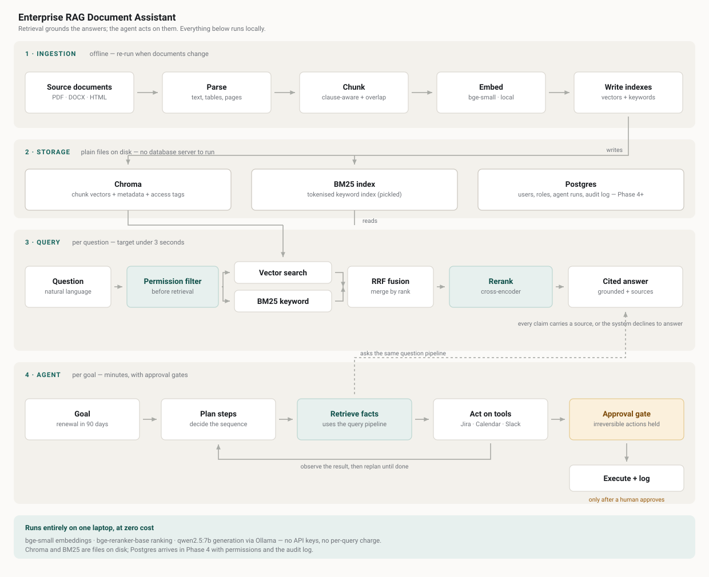

# Chunktra — Enterprise RAG Document Assistant

Ask a question about your own documents. Get an answer with the exact clause
quoted and a pointer to the page it came from — or an honest "the documents
don't cover this."

Runs entirely on a laptop. No API keys, no per-query cost.



---

## The problem

A procurement manager is asked something that sounds simple: *"Can we get out
of the ABC Company contract this year, and what would it cost us?"*

The answer exists. It is in a 47-page agreement, in a clause that reads *"either
party may give ninety (90) days written notice prior to the end of the
then-current term."* Finding it takes most of an hour — not because the work is
difficult, but because it is scattered: across a document nobody has read end to
end, an amendment filed separately that quietly changed the fee cap, and an
internal policy setting a ceiling the contract may or may not breach.

Then the actual work begins. Email the contract owner. Set a reminder before the
notice deadline. Open a ticket so it doesn't get dropped during a busy quarter.
Another hour, most of it copying facts from one window into another.

Multiply by four hundred contracts and a renewal calendar that never stops. The
failure mode isn't someone getting an answer wrong — it's an agreement renewing
automatically because the deadline passed while the question sat in an inbox.

### Why the obvious fixes don't work

**Keyword search** matches strings; people ask questions. Searching *"termination
notice period"* will not surface *"either party may give ninety days written
notice"* — the two phrases share no words.

**A general-purpose chatbot** has never seen your contract. It read a great many
contracts during training, most of which say 30, 60 or 90 days, so it produces a
confident, plausible answer. An unsourced answer is indistinguishable from a
correct one until somebody checks, and nobody checks an answer that sounds right.

**Pasting the document into a chat window** genuinely works, and for a single
document it is the correct answer. It breaks at four hundred documents, where you
no longer know which one to paste — and it assumes everyone may read everything.

### The problem, stated

Organisations need to ask natural-language questions of their own documents and
receive answers that are **verifiable** (every claim traceable to a specific
page) and **permission-respecting** (you only retrieve from what you may read) —
and then have the routine follow-up work carried out automatically, under human
approval, rather than by hand.

### What this does not solve

- **It is not legal advice.** It locates and quotes what a document says.
  Deciding what to do about it is a person's job.
- **It cannot read what it cannot parse.** Scanned contracts are invisible until
  OCR lands in Phase 3.
- **It does not resolve contradictions.** If three versions of a policy disagree,
  it faithfully surfaces whichever it retrieves. RAG makes conflicting documents
  visible rather than fixing them.
- **It does not decide.** The agent drafts, schedules and flags. Anything
  irreversible waits for a human.

---

## Results

Measured on a 27-question labelled set (24 answerable, 3 deliberately
unanswerable) over a 4-document, 29-chunk corpus. Reproduce with
`python eval/run_eval.py --compare`.

| Configuration | Recall@5 | MRR |
|---|---|---|
| Hybrid, no rerank | TODO | TODO |
| Hybrid + cross-encoder rerank | TODO | TODO |

**Recall@5** — did the correct passage reach the top 5? If it didn't, the model
never sees it and no prompting recovers it.
**MRR** — how high it ranked. 1.0 means always first.

---

## Status

Phase 2 of 8 complete.

- [x] **Phase 1** — Baseline RAG: parse, chunk, embed, retrieve, cite
- [x] **Phase 2** — Evaluation harness and baseline accuracy numbers
- [ ] **Phase 3** — Chunking experiments, OCR, retrieval tuning
- [ ] **Phase 4** — Auth, roles, permission-filtered retrieval, audit log
- [ ] **Phase 5** — Autonomous agent with approval gates
- [ ] **Phase 6** — Error handling, caching, CI
- [ ] **Phase 7** — Deployment, demo, write-up

---

## Quick start

Requires Python 3.11+ and [Ollama](https://ollama.com).

```bash
ollama pull qwen2.5:7b-instruct     # 8 GB RAM? use llama3.2:3b
brew services start ollama          # or run `ollama serve` in another tab

make install
cp .env.example .env
cp data/samples/*.txt data/raw/
make ingest
make ui
```

Then ask: *"What is the notice period for terminating the master services
agreement?"*

| Command | Does |
|---|---|
| `make ingest` | Rebuild both indexes from `data/raw/` |
| `make api` | FastAPI at `localhost:8001` (docs at `/docs`) |
| `make ui` | Streamlit interface |
| `make eval` | Measure retrieval accuracy |
| `make test` | Unit tests |

Four synthetic sample contracts ship in `data/samples/` so the project runs out
of the box. To use real documents, drop them in `data/raw/` and re-ingest. The
[CUAD dataset](https://zenodo.org/records/4595826) is free and ships with expert
clause annotations, which makes building a larger evaluation set much easier.

---

## How it works

Three decisions worth explaining, because that's where the engineering is:

**Structure-aware chunking.** Documents split on paragraph and numbered-clause
boundaries before being packed to a size budget, rather than cut at a fixed
width. A fixed-width split severs clauses in half and retrieval never recovers —
half a termination clause retrieved perfectly is still a wrong answer.
See `app/ingestion/chunk.py`.

**Hybrid retrieval with rank fusion.** Vector search catches meaning; BM25
catches exact terms like clause numbers that embeddings blur. Their scores aren't
on the same scale, so Reciprocal Rank Fusion merges by rank position rather than
averaging. A cross-encoder then reranks the survivors.

**Access tags from day one.** Every chunk carries an `access_tags` field even
though Phase 1 sets it to `public`. Permission filtering happens at retrieval
time — before the model sees a passage — so Phase 4 is a filter change rather
than a full re-index.

The [wiki](../../wiki) covers all of this in depth.

---

## API

```bash
curl -X POST localhost:8001/ask \
  -H 'Content-Type: application/json' \
  -d '{"question": "What is the notice period for termination?"}'
```

`POST /search` runs retrieval with no LLM. It's the first thing to check when an
answer looks wrong, because most bad answers are bad retrieval.

---

## Limitations

- Scanned PDFs are not OCR'd — image-only documents index as empty.
- Table extraction is text-flow only; multi-column schedules lose structure.
- A chunk is labelled with the section it *starts* in, so a chunk spanning 12.2
  into 12.3 is cited as 12.2. Phase 3.
- Permissions are stubbed until Phase 4.
- Sample contracts in `data/samples/` are synthetic, written for testing.
- The evaluation corpus is small. Numbers above are a floor, not a claim about
  behaviour at scale.

---

## Tools and languages

**Python 3.11+** throughout. SQL for the Phase 4 schema. No JavaScript — the
interface renders from Python via Streamlit.

| Layer | Tool |
|---|---|
| API | FastAPI · Uvicorn |
| Parsing | PyMuPDF · python-docx · BeautifulSoup · Tesseract *(Phase 3)* |
| Embeddings | sentence-transformers — `bge-small-en-v1.5` |
| Vector store | ChromaDB |
| Keyword search | rank-bm25 |
| Reranking | `bge-reranker-base` cross-encoder |
| Generation | Ollama — `qwen2.5:7b-instruct` |
| Database | PostgreSQL · SQLAlchemy *(Phase 4)* |
| Interface | Streamlit |
| Testing | pytest · custom evaluation harness |
| Packaging | make · Docker *(Phase 6)* |

Every tool is free and open source; all three models run locally. Total project
cost: zero.

---

## Project ownership

**Puneet Tulsiani** — product owner and sole developer.

[GitHub](https://github.com/puneett12) ·
[LinkedIn](https://linkedin.com/in/puneettulsiani)

Issues and suggestions welcome.

---

## Layout

```
app/
  ingestion/   parse.py, chunk.py              document → chunks
  retrieval/   embed.py, store.py, search.py   hybrid search + rerank
  generation/  llm.py, answer.py               grounded prompting
  main.py                                      FastAPI endpoints
eval/          questions.yaml, run_eval.py
scripts/       ingest.py
ui/            streamlit_app.py
tests/
docs/          architecture.svg
data/samples/  four synthetic contracts
```

## Licence

MIT — see [LICENSE](LICENSE).
